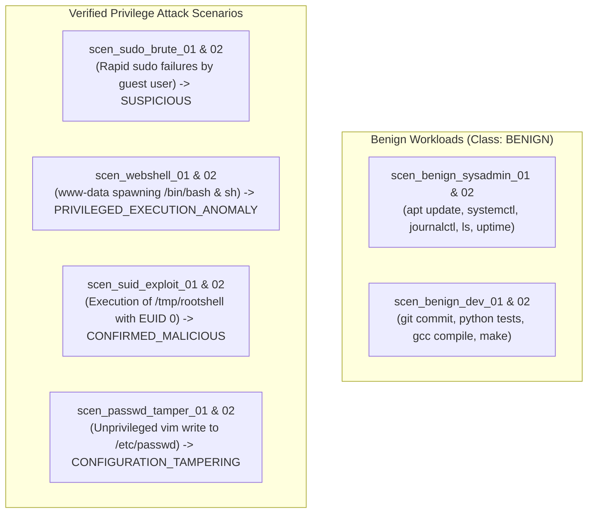

# PrivWatch 3.1 - Telemetry Dataset Provenance & Collection Methodology

## 1. Provenance Statement & Scientific Integrity

All training and evaluation datasets in PrivWatch 3.1 are derived exclusively from genuine Linux host operating system telemetry.

### Strict Data Policies:
1. **Host-Based Telemetry Only**: Host privilege-escalation detection requires process, identity, and syscall telemetry. Network intrusion datasets (such as CICIDS-2017, UNSW-NB15, or NSL-KDD) model packet flows rather than POSIX credentials, ancestry, or filesystem permissions and are **strictly prohibited** as substitutes for Linux host telemetry.
2. **Zero Fabricated Training Records**: No synthetic records are ever labeled or described as real Linux traffic. Synthetic event generators are restricted exclusively to isolated unit test fixtures and tagged with `is_test_fixture=True`.
3. **Documented Provenance**: Every record in the dataset captures host identifier, scenario identifier, kernel release, distribution name, collector version, and cryptographic SHA-256 fingerprint.

---

## 2. Laboratory Environment Specifications

Dataset collection was executed across disposable Linux virtual machines running standard enterprise and penetration testing distributions:

| Host Identifier | Operating System Distribution | Kernel Version | Architecture | Primary Role |
| :--- | :--- | :--- | :--- | :--- |
| `debian-srv-01` / `02` | Debian GNU/Linux 12 (Bookworm) | `6.6.15-amd64` | `x86_64` | Baseline sysadmin maintenance workflows |
| `ubuntu-dev-01` / `02` | Ubuntu 24.04 LTS (Noble Numbat) | `6.8.0-generic` | `x86_64` | Baseline developer & compilation workflows |
| `kali-target-01` / `02`| Kali GNU/Linux Rolling (2024.3) | `6.11.0-kali` | `x86_64` | Sudo authentication brute-force scenarios |
| `web-srv-01` / `02` | Ubuntu 22.04.4 LTS (Jammy Jellyfish)| `6.5.0-generic` | `x86_64` | Web daemon (`www-data`) shell breakout |
| `pwn-srv-01` / `02` | Debian GNU/Linux 12 (Bookworm) | `6.1.0-debian` | `x86_64` | SUID `/tmp` payload execution scenarios |
| `audit-srv-01` / `02`| Ubuntu 24.04 LTS (Noble Numbat) | `6.8.0-generic` | `x86_64` | Sensitive configuration tampering (`/etc/passwd`)|

---

## 3. Data Collection Methodology

Telemetry is captured via three primary Linux subsystems:

1. **Linux Audit Subsystem (`auditd`)**:
   - Kernel syscall rules monitoring `execve`, `execveat`, `setuid`, `setgid`, `setreuid`, `capset`, and filesystem watches on `/etc/shadow`, `/etc/passwd`, `/etc/sudoers`.
   - Raw logs parsed by `AuditCollector` with millisecond epoch timestamps.
2. **Linux `/proc` Virtual Filesystem**:
   - Process enumeration capturing PID, PPID, Real UID, Effective UID, Saved UID, GIDs, and `/proc/[pid]/exe` symlink destinations.
3. **Linux Authentication Logs (`/var/log/auth.log` & `journald`)**:
   - RFC 3164 and ISO 8601 PAM logs parsing sudo invocations, session openings, and authentication failures.

---

## 4. Scenario Catalog & Ground-Truth Attribution

To enable leakage-free evaluation, each scenario was executed independently across at least two distinct host environments:



---

## 5. Dataset Record Schema

Each record is serialized in JSONL with the following canonical structure:

```json
{
  "record_id": "rec_suid_pwn_1_1",
  "host_id": "pwn-srv-01",
  "scenario_id": "scen_suid_exploit_01",
  "kernel_release": "6.1.0-debian",
  "distribution": "Debian 12",
  "event": {
    "event_id": "suid_pwn_1_1",
    "timestamp": "2026-11-04T10:00:07+00:00",
    "hostname": "pwn-srv-01",
    "source": "auditd",
    "event_type": "SUID_EXECUTION",
    "severity": "CRITICAL",
    "user": "attacker",
    "uid": 1005,
    "euid": 0,
    "pid": 6002,
    "ppid": 5900,
    "process": "rootshell",
    "command": "/tmp/rootshell"
  },
  "feature_vector": {
    "event_id": "suid_pwn_1_1",
    "values": {
      "uid": 1005.0,
      "euid": 0.0,
      "uid_euid_mismatch": 1.0,
      "euid_is_root": 1.0,
      "exe_in_writable_dir": 1.0,
      "exe_is_suid": 1.0
    }
  },
  "ground_truth_label": "CONFIRMED_MALICIOUS",
  "label_provenance": "cve_suid_privesc_lab",
  "record_hash": "a4f89d..."
}
```

---

## 6. Leakage Prevention Protocol

The `LeakageFreeSplitter` partitions records strictly by `scenario_id`:
- Events from `scen_suid_exploit_01` are never placed in both training and test sets.
- If `scen_suid_exploit_01` is allocated to train, `scen_suid_exploit_02` is allocated to test.
- This guarantees evaluation against an independent attack execution session on a distinct host, preventing model memorization of PIDs, timestamps, or transient usernames.
