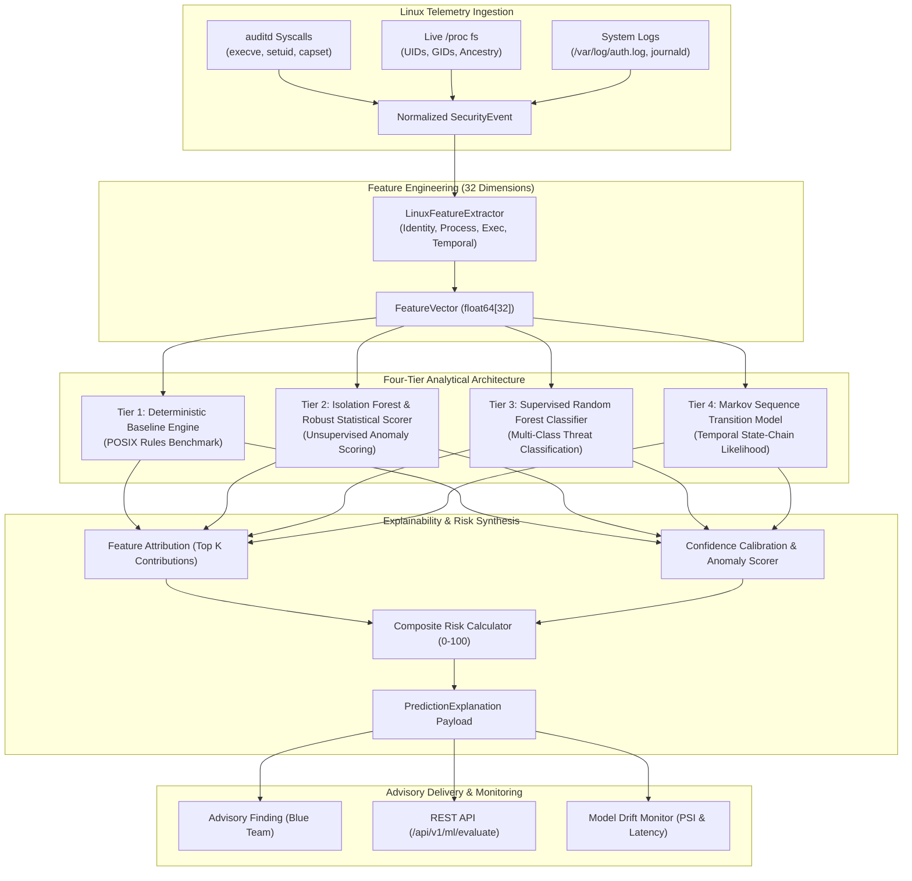

# PrivWatch 3.1 - Machine Learning & Statistical Detection Architecture

## 1. Architectural Overview

PrivWatch 3.1 implements an evidence-driven, four-tier hybrid analytical architecture specifically designed for host-based Linux privilege-escalation detection.

The system combines deterministic POSIX rules with unsupervised outlier scoring, supervised tree ensembles, and sequential Markov chain modeling. Every model operates strictly on CPU with low latency ($< 5$ ms), bounded memory footprint, and non-blocking failure tolerance.

---

## 2. Four-Tier Detection Architecture

### Tier 1: Deterministic Baseline Engine (`models/baseline/baseline_detector.py`)
- **Role**: Ground-truth benchmark implementing established POSIX security heuristics.
- **Rules Evaluated**:
  1. `EUID_ROOT_IN_WRITABLE_DIR`: Effective UID 0 execution originating from world-writable paths (`/tmp`, `/dev/shm`).
  2. `ACTIVE_EUID_ELEVATION`: Runtime privilege transition where real UID $\ne$ effective UID and EUID $= 0$.
  3. `DAEMON_SPAWNED_SHELL`: Service accounts (`www-data`, `nobody`, `daemon`) executing interactive shells (`sh`, `bash`).
  4. `SUDO_BRUTE_FORCE_WINDOW`: $\ge 3$ authentication failures within recent 300-second window.
  5. `UNPRIVILEGED_SENSITIVE_WRITE`: Non-root user modifying `/etc/passwd`, `/etc/shadow`, or `/etc/sudoers`.
- **Latency**: $< 0.05$ ms.

### Tier 2: Unsupervised Anomaly Detection (`models/anomaly/`)
- **Components**:
  1. `LinuxIsolationForestDetector`: Ensemble of 50 decision trees partitioning the 32-dimensional feature space. Flags multidimensional outliers with normalized anomaly scores in $[0.0, 1.0]$.
  2. `RobustStatisticalScorer`: Dual-redundancy non-parametric detector using Median Absolute Deviation (MAD) and modified Z-scores:
     $$M_i = \frac{0.6745 \cdot |x_i - \text{median}(x)|}{\text{MAD}_i}$$
     Aggregates the top 3 outlier dimensions into an anomaly score using a sigmoid mapping function.
- **Role**: Detects novel or unmodeled privilege transitions without requiring pre-labeled attack data.
- **Latency**: $0.4 - 1.8$ ms.

### Tier 3: Supervised Threat Classification (`models/classification/privilege_classifier.py`)
- **Algorithm**: Balanced Random Forest ensemble (50 trees, max depth 8) trained on verified Linux laboratory telemetry records.
- **Classes**:
  - `BENIGN`
  - `SUSPICIOUS`
  - `PRIVILEGE_TRANSITION_ANOMALY`
  - `PRIVILEGED_EXECUTION_ANOMALY`
  - `CONFIGURATION_TAMPERING`
  - `CONFIRMED_MALICIOUS`
- **Confidence Gate**: Requires maximum calibrated class probability $\ge 0.45$. Predictions below threshold are assigned status `INSUFFICIENT_EVIDENCE` or `UNKNOWN`.
- **Latency**: $1.2 - 3.5$ ms.

### Tier 4: Sequential Markov Transition Model (`models/sequence/markov_sequence.py`)
- **Algorithm**: First-Order Markov Chain with Laplace smoothing ($\alpha = 0.05$) across 8 abstract security states:
  - `UNPRIV_EXEC`, `AUTH_FAILURE`, `SUDO_INVOKE`, `SUID_ELEVATE`, `DAEMON_SERVICE`, `CONFIG_TAMPER`, `EVASION_EXEC`, `ROOT_EXEC`.
- **Sequence Log-Likelihood**:
  $$\log P(S_1, \dots, S_T) = \sum_{t=2}^T \log P(S_t \mid S_{t-1})$$
- **Rare Transition Flags**: Transitions with empirical transition probability $P(S_t \mid S_{t-1}) < 0.05$ are explicitly highlighted.
- **Latency**: $< 0.15$ ms.

---

## 3. 32-Dimensional Canonical Feature Space

| Index | Feature Identifier | Type | Range / Encoding | Telemetry Source |
| :--- | :--- | :--- | :--- | :--- |
| 0 | `uid` | Numerical | $[-1, 65535]$ | `/proc/status`, auditd SYSCALL |
| 1 | `euid` | Numerical | $[-1, 65535]$ | `/proc/status`, auditd SYSCALL |
| 2 | `gid` | Numerical | $[-1, 65535]$ | `/proc/status`, auditd SYSCALL |
| 3 | `egid` | Numerical | $[-1, 65535]$ | `/proc/status`, auditd SYSCALL |
| 4 | `uid_euid_mismatch` | Binary | $\{0.0, 1.0\}$ | Derived identity check |
| 5 | `euid_is_root` | Binary | $\{0.0, 1.0\}$ | `euid == 0` |
| 6 | `uid_is_root` | Binary | $\{0.0, 1.0\}$ | `uid == 0` |
| 7 | `pid` | Numerical | $[-1, 4194304]$ | Kernel PID |
| 8 | `ppid` | Numerical | $[-1, 4194304]$ | Kernel PPID |
| 9 | `pid_ppid_diff` | Numerical | $[0, 4194304]$ | Ancestry gap $|PID - PPID|$ |
| 10 | `ancestry_depth` | Numerical | $[1.0, 20.0]$ | Process tree traversal |
| 11 | `is_daemon_user` | Binary | $\{0.0, 1.0\}$ | Membership in service daemon list |
| 12 | `is_interactive_shell` | Binary | $\{0.0, 1.0\}$ | Binary name in standard shell list |
| 13 | `is_script_interpreter`| Binary | $\{0.0, 1.0\}$ | Binary name in script interpreters |
| 14 | `is_network_tool` | Binary | $\{0.0, 1.0\}$ | Binary name in network utilities |
| 15 | `exe_in_writable_dir` | Binary | $\{0.0, 1.0\}$ | Binary resides in `/tmp`, `/dev/shm`, etc. |
| 16 | `exe_is_suid` | Binary | $\{0.0, 1.0\}$ | SUID bit active or SUID execution event |
| 17 | `exe_is_sgid` | Binary | $\{0.0, 1.0\}$ | SGID bit active |
| 18 | `has_file_capabilities`| Binary| $\{0.0, 1.0\}$ | Linux POSIX capabilities active |
| 19 | `modifies_sensitive_file`| Binary| $\{0.0, 1.0\}$ | Path references `/etc/passwd`, `/etc/shadow`, etc. |
| 20 | `syscall_is_elevating` | Binary | $\{0.0, 1.0\}$ | `setuid`, `capset`, `execveat`, `init_module` |
| 21 | `command_length` | Numerical | $[0, 4096]$ | String character count |
| 22 | `command_arg_count` | Numerical | $[0, 256]$ | Space-delimited token count |
| 23 | `command_has_pipes` | Binary | $\{0.0, 1.0\}$ | Contains `\|`, `;`, `&&`, or `\|\|` |
| 24 | `source_is_auditd` | Binary | $\{0.0, 1.0\}$ | Originates from kernel audit subsystem |
| 25 | `source_is_procfs` | Binary | $\{0.0, 1.0\}$ | Originates from `/proc` or `psutil` |
| 26 | `source_is_auth_log` | Binary | $\{0.0, 1.0\}$ | Originates from `/var/log/auth.log` |
| 27 | `events_last_10s` | Numerical | $[0, 1000]$ | Temporal sliding window count (10 seconds) |
| 28 | `events_last_60s` | Numerical | $[0, 5000]$ | Temporal sliding window count (60 seconds) |
| 29 | `auth_fails_last_300s` | Numerical | $[0, 500]$ | Authentication failures within 5 minutes |
| 30 | `time_delta_prev_event`| Numerical | $[0.0, 3600.0]$ | Inter-event interval in seconds |
| 31 | `consecutive_priv_events`| Numerical | $[0, 100]$ | Consecutive elevated actions |

---

## 4. Explainability & Composite Risk Formulation

### Feature Attribution
Every prediction computes the top 4 contributing features:
$$\text{Weight}_j = \left(I_j + 0.3 \cdot |Z_j|\right) \cdot \text{FlagBoost}_j$$
where $I_j$ is the tree feature importance, $Z_j$ is the modified Z-score, and $\text{FlagBoost}_j$ amplifies active binary indicators.

### Composite Risk Index
$$R = \min\left(100, \max\left(0, \left(0.35 \cdot S_{\text{anom}} + 0.35 \cdot W_{\text{class}} + 0.20 \cdot C_{\text{conf}} + 0.10 \cdot Q_{\text{source}}\right) \times 100\right)\right)$$
where $S_{\text{anom}} \in [0, 1]$ is anomaly score, $W_{\text{class}}$ is class severity weight, $C_{\text{conf}}$ is calibrated confidence, and $Q_{\text{source}}$ is source reliability.

---

## 5. Non-Blocking Production Guarantees

1. **CPU Execution Only**: Zero GPU dependencies. Runs on standard Kali/Debian/Ubuntu/RHEL kernels.
2. **Telemetry Independence**: Telemetry collection threads never block on model inference.
3. **Graceful Fallback**: If models are corrupt or uninitialized, inference falls back immediately to `DeterministicBaselineModel`.
