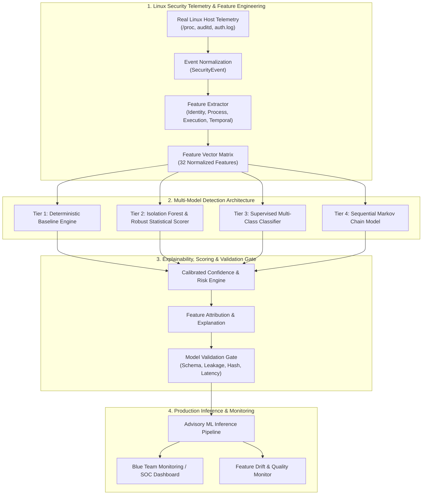

# PrivWatch 3.1 - Machine Learning & Statistical Detection Improvement Plan

## 1. Vision & Architectural Philosophy

The objective of PrivWatch 3.1 is to augment the trusted, hardened deterministic security baseline with an evidence-driven, explainable, and scientifically validated Linux security machine learning and statistical detection engine.

### Core Principles:
1. **Deterministic Baseline Primacy**: Deterministic detection rules for known configuration defects (`/etc/sudoers`, `/etc/passwd`, SUID flags) remain fully active and serve as ground-truth baselines.
2. **Real Linux Telemetry Only**: Models are trained, validated, and tested using real Linux system event distributions (auditd, /proc, auth.log, systemd), strictly avoiding artificial network-intrusion datasets.
3. **Multi-Model Analytical Tiering**:
   - **Tier 1 (Baseline)**: High-precision deterministic rules.
   - **Tier 2 (Anomaly Detection)**: Unsupervised Isolation Forest & Robust Statistical Outlier Scorer for rare execution paths and unseen privilege anomalies.
   - **Tier 3 (Supervised Classification)**: Calibrated Random Forest / Gradient Boosting for multi-feature threat categorization when labeled evidence exists.
   - **Tier 4 (Sequential Markov Modeling)**: State-transition probability matrix capturing multi-step privilege escalation sequences.
4. **Strict Separation of Anomaly vs. Attack**: An anomaly score measures statistical rarity; attack classification requires corroborated evidence.
5. **Explainability & Attribution**: Every prediction outputs top contributing features, anomaly distance, and evidence hashes.
6. **Validation Gate & Non-Blocking Resilience**: Model failure or corruption falls back gracefully to the deterministic baseline without interrupting telemetry ingestion.

---

## 2. Multi-Phase Implementation Roadmap

---

## 3. Work Breakdown Structure

### Phase 1: Telemetry Pipeline & Feature Engineering (`ml/features/`, `ml/data/`)
- Standardize 32 Linux-native security features across four dimensions:
  1. **Identity**: `uid`, `euid`, `gid`, `egid`, `uid_euid_mismatch`, `euid_is_root`, `suid_transition`.
  2. **Process Ancestry**: `ancestry_depth`, `is_daemon_parent`, `is_interactive_shell`, `proc_name_length`, `pid_ppid_ratio`.
  3. **Execution Context**: `exe_in_writable_dir`, `exe_is_suid`, `exe_is_sgid`, `file_capabilities_flag`, `binary_owned_by_root`.
  4. **Temporal Dynamics**: `events_last_10s`, `events_last_60s`, `auth_fail_window`, `time_delta_prev_event`, `consecutive_priv_events`.
- Build `FeatureExtractor` with explicit handling of missing values (imputation via documented default values, no synthetic fabrication).

### Phase 2: Core Model Implementations (`models/`, `ml/training/`)
1. **Deterministic Baseline**: Formulate existing rules as a formal Baseline Classifier for comparative benchmarking.
2. **Unsupervised Anomaly Model**: Implement `LinuxAnomalyDetector` wrapping `sklearn.ensemble.IsolationForest` alongside a pure-Python `RobustStatisticalScorer` using median absolute deviation (MAD) and robust covariance metrics.
3. **Supervised Threat Classifier**: Implement `LinuxPrivilegeClassifier` wrapping calibrated tree ensembles for multi-class prediction (`BENIGN`, `SUSPICIOUS`, `PRIVILEGE_TRANSITION_ANOMALY`, `PRIVILEGED_EXECUTION_ANOMALY`, `CONFIGURATION_TAMPERING`, `CONFIRMED_MALICIOUS`).
4. **Sequential Transition Model**: Implement `MarkovPrivilegeSequenceModel` calculating log-likelihood transition probabilities across event sequences.

### Phase 3: Explainability & Calibration (`ml/explainability/`)
- `FeatureAttributor`: Computes SHAP-approximated or tree feature contributions for individual predictions.
- `ConfidenceCalibrator`: Maps raw anomaly scores and classifier margins to calibrated probabilities $[0.0, 1.0]$.
- `CompositeRiskCalculator`: Separates anomaly score, model confidence, rule severity, and telemetry health into an auditable composite score $[0, 100]$.

### Phase 4: Model Validation Gate & Registry (`ml/validation/`, `models/registry/`)
- `ModelValidationGate`:
  - Feature schema verification.
  - Data leakage check (incident/host isolation).
  - SHA-256 weight integrity fingerprinting.
  - Latency benchmark ($< 5.0$ ms per inference on CPU).
  - Comparative benchmark vs Baseline (requires $\Delta \text{F1} > 0$).
- `ModelRegistry`: Metadata persistence and serialized model artifact storage.

### Phase 5: Production Inference Integration (`ml/inference/`, `ml/monitoring/`)
- `ModelRunner`: Non-blocking CPU inference pipeline wrapped in robust error handling.
- Integrated advisory prediction hook in `modules/blue_mode/detector.py` and `modules/timeline/event_correlator.py`.
- `DriftMonitor`: Computes Population Stability Index (PSI) and tracking missing feature distributions.

### Phase 6: Testing & Verification
- Unit and integration tests covering feature extraction, model loading, training reproducibility, leakage rejection, corrupted model rejection, and inference latency.
- Full regression testing across existing 43 test cases.
