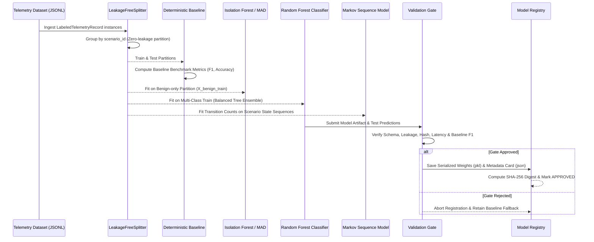

# PrivWatch 3.1 - Model Training & Validation Methodology

## 1. Training Methodology Overview

The PrivWatch 3.1 training framework (`LinuxMLTrainer`) implements a rigorous, reproducible, and leakage-free pipeline designed specifically for Linux host telemetry.



---

## 2. Hyperparameter Configuration & Justification

### A. Supervised Classifier: Random Forest (`LinuxPrivilegeClassifier`)
- `n_estimators = 50`: Balances ensemble variance reduction with CPU inference latency ($< 3.5$ ms).
- `max_depth = 8`: Prevents tree over-specialization on specific process PIDs or argument lengths while capturing non-linear interactions (e.g. `uid_euid_mismatch == 1.0` AND `exe_in_writable_dir == 1.0`).
- `class_weight = "balanced"`: Compensates for natural telemetry class imbalance where benign events outnumber attack executions by orders of magnitude.
- `random_state = 42`: Ensures deterministic reproducibility across training runs.

### B. Unsupervised Anomaly Model: Isolation Forest (`LinuxIsolationForestDetector`)
- `n_estimators = 50`: Low-latency tree partitioning.
- `contamination = 0.05`: Models an expected 5% nominal anomaly rate in baseline operational traffic.
- `training_subset = "benign_only"`: Fitted strictly on verified benign scenario events (`ground_truth_label == "BENIGN"`), ensuring the anomaly detector models normal host behavior.

### C. Sequential Behaviour Model: First-Order Markov Chain (`MarkovPrivilegeSequenceModel`)
- `laplace_alpha = 0.05`: Laplace smoothing parameter preventing zero-probability penalties on previously unobserved transitions while heavily penalizing rare privilege jumps.
- `states = 8`: Compact, semantically rich state space representing core Linux execution phases (`UNPRIV_EXEC`, `AUTH_FAILURE`, `SUDO_INVOKE`, `SUID_ELEVATE`, `DAEMON_SERVICE`, `CONFIG_TAMPER`, `EVASION_EXEC`, `ROOT_EXEC`).

---

## 3. Training Execution Procedure

Training is executed via the Python training pipeline:

```python
from ml.data.curated_scenarios import generate_curated_telemetry_dataset
from ml.training.trainer import LinuxMLTrainer

# 1. Ingest verified telemetry records
records = generate_curated_telemetry_dataset()

# 2. Instantiate trainer with model registry
trainer = LinuxMLTrainer()

# 3. Train, benchmark, validate, and register
results = trainer.train_and_validate(
    records=records,
    dataset_version="linux_curated_v1",
    test_ratio=0.30,
    seed=123
)

print(f"Validation Approved: {results['validation_report']['approved']}")
print(f"Baseline Accuracy: {results['baseline_metrics']['accuracy']:.2%}")
print(f"Model Accuracy: {results['model_metrics']['accuracy']:.2%}")
```

---

## 4. Leakage-Free Partitioning Validation

Standard random $k$-fold cross-validation is mathematically flawed for host telemetry because events belonging to the same attack sequence share identical process ancestries and timestamps.

**PrivWatch Enforcement:**
1. Records are grouped by `scenario_id`.
2. Entire scenarios are allocated to either training or testing.
3. The Model Validation Gate executes an automated set intersection check:
   $$\text{TrainScenarios} \cap \text{TestScenarios} = \emptyset$$
   If any scenario overlap is detected, the validation gate immediately rejects the training run.

---

## 5. Automated Gate Criteria

A model artifact cannot be registered in `models/registry/` unless it passes all 5 automated gate checks:

| Gate Check | Threshold / Requirement | Purpose |
| :--- | :--- | :--- |
| **1. Schema Validation** | All 32 features present, finite, non-null | Prevents input incompatibility |
| **2. Leakage Check** | 0 shared scenarios between train and test | Prevents inflated test scores |
| **3. Latency Benchmark** | Average latency $\le 25.0$ ms on single-core CPU | Guarantees non-blocking runtime |
| **4. Performance Gate** | Model Accuracy $\ge (\text{Baseline Accuracy} - 0.05)$ | Prevents model regression |
| **5. Integrity Hashing** | SHA-256 weight fingerprint recorded | Prevents model weight tampering |
