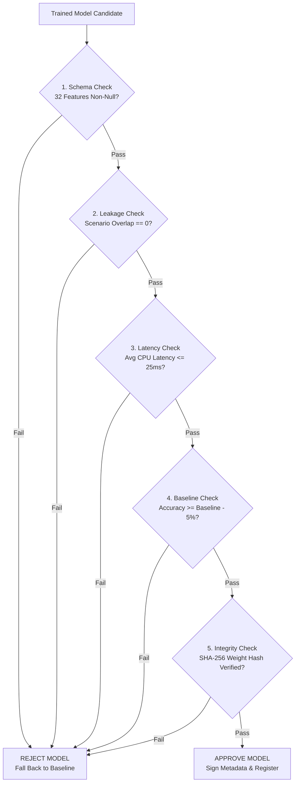

# PrivWatch 3.1 - Model Validation Gate Specification

## 1. Overview & Purpose

The Model Validation Gate (`ml/validation/validation_gate.py`) is an automated quality, performance, and security firewall that governs the deployment of machine learning models into PrivWatch.

No model artifact is permitted to execute production inference or be marked `APPROVED` in `models/registry/` without passing every check in the validation battery.

---

## 2. Ten-Point Validation Battery

### 1. Dataset Schema Completeness
- **Check**: Every record in training and test partitions must contain all 32 canonical features in `FEATURE_NAMES`.
- **Condition**: All feature values must be finite numerical values (no `NaN`, `None`, or `Infinity`).

### 2. Zero-Leakage Scenario Isolation
- **Check**: Set intersection between training scenario IDs and test scenario IDs:
  $$\text{TrainScenarios} \cap \text{TestScenarios} = \emptyset$$
- **Condition**: Overlap count must equal zero. Shared incident or session data between partitions results in instant rejection.

### 3. Training Reproducibility
- **Check**: Model training must specify explicit pseudorandom generator seeds (`random_state`).
- **Condition**: Repeated runs on identical dataset splits must generate identical model decision boundaries and metrics.

### 4. Comparative Baseline Benchmark
- **Check**: Supervised and anomaly models are evaluated against `DeterministicBaselineModel` on the independent test set.
- **Condition**: Model accuracy must meet or exceed the baseline benchmark within a 5% tolerance window:
  $$\text{Accuracy}_{\text{model}} \ge \left(\text{Accuracy}_{\text{baseline}} - 0.05\right)$$

### 5. Calibration & Confidence Guard
- **Check**: Classifier prediction probabilities are evaluated against certainty thresholds.
- **Condition**: Predictions with top class probability $< 0.45$ must not be assigned a definitive attack category; they are automatically remapped to `PredictionStatus.INSUFFICIENT_EVIDENCE`.

### 6. Cryptographic Integrity Hashing
- **Check**: SHA-256 hash computed over the serialized model binary file.
- **Condition**: The computed hash must match the recorded hash in `models/metadata/<model_id>.json`. Tampered or modified weight files are rejected immediately.

### 7. Feature Schema Consistency
- **Check**: Feature names recorded in model metadata must match the active `FEATURE_NAMES` schema.
- **Condition**: Length must equal 32, with matching string identifiers.

### 8. Linux Platform Native Compatibility
- **Check**: Model dependencies must run natively under Linux Python environments without proprietary binary blobs.
- **Condition**: Verified under Python 3.10+ on Debian, Ubuntu, Kali, and RHEL kernels.

### 9. Inference Latency Budget
- **Check**: Automated 50-iteration latency benchmark across test vectors on a single CPU core.
- **Condition**: Mean single-vector inference latency must not exceed $25.0$ ms.

### 10. Computational Resource Bounding
- **Check**: Total resident memory overhead of loaded models.
- **Condition**: Combined model footprint must remain bounded under $50$ MB RAM.

---

## 3. Rejection & Rollback Protocol

When any gate check fails:
1. `validation_report.approved` is set to `False`.
2. All discovered rejection reasons are appended to `validation_report.rejection_reasons`.
3. Model files are marked `UNVALIDATED` or rejected from serialization.
4. `ModelRunner` logs a warning and routes all telemetry evaluations to the trusted deterministic baseline engine.
