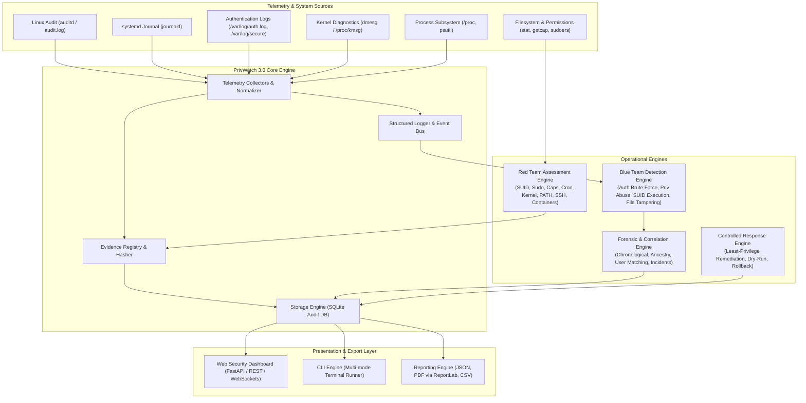

# PrivWatch 3.0 — Platform Architecture Specification

**Status:** Approved Architectural Baseline  
**Version:** 3.0.0  
**Component:** System Architecture & Data Flow  

---

## 1. System Overview & Philosophy

PrivWatch 3.0 is a modular, evidence-driven security platform engineered for Linux privilege escalation auditing, continuous telemetry monitoring, forensic incident reconstruction, and controlled defensive remediation.

### Core Tenets
1. **Evidence Integrity:** Every finding, alert, or incident must reference real system telemetry with cryptographic hashing of evidence. No fabricated telemetry or synthetic detections.
2. **Defensive Rigor:** PrivWatch is an auditing and defense platform. All findings provide least-privilege remediation and defensive hardening guidance.
3. **Distribution Awareness:** Native awareness of Debian/Ubuntu, RHEL/Fedora/CentOS, Arch Linux, and generic POSIX systems with graceful degradation when optional telemetry subsystems (such as auditd or systemd) are absent.
4. **Safety by Default:** Monitoring and auditing operations are read-only. Any operational intervention requires explicit administrative confirmation and dry-run validation.

---

## 2. High-Level Architecture Diagram



---

## 3. Data Schemas & Models

### 3.1 Normalized Security Event (`SecurityEvent`)

Every ingested log line, audit record, or process anomaly is normalized into a standard model:

```json
{
  "event_id": "evt_01JBCDEF890123456789ABCDEF",
  "timestamp": "2026-11-03T18:15:30.123456Z",
  "hostname": "srv-prod-app01",
  "source": "auditd",
  "event_type": "PRIVILEGED_EXECVE",
  "severity": "HIGH",
  "user": "webadmin",
  "uid": 1001,
  "euid": 0,
  "gid": 1001,
  "egid": 0,
  "pid": 28412,
  "ppid": 14201,
  "process": "pkexec",
  "command": "/usr/bin/pkexec --user root /bin/bash",
  "evidence": {
    "syscall": 59,
    "success": "yes",
    "terminal": "pts/2",
    "raw_record": "type=SYSCALL msg=audit(1730657730.123:452): arch=c000003e syscall=59 success=yes exit=0 ...",
    "record_hash": "e3b0c44298fc1c149afbf4c8996fb92427ae41e4649b934ca495991b7852b855"
  },
  "confidence": 0.95
}
```

### 3.2 Security Finding (`Finding`)

Findings generated by static vulnerability scanners or policy auditors:

```json
{
  "finding_id": "fnd_suid_gtfobins_vim_01",
  "vector": "SUID/SGID",
  "severity": "CRITICAL",
  "confidence": 0.98,
  "title": "Exploitable SUID Binary: /usr/bin/vim.basic",
  "description": "The vim.basic binary has the SUID permission bit set (owner root) and allows command execution with preserved privileges.",
  "affected_resource": "/usr/bin/vim.basic",
  "evidence": {
    "path": "/usr/bin/vim.basic",
    "permissions": "-rwsr-xr-x",
    "owner": "root",
    "group": "root",
    "stat": {"mode": 35309, "uid": 0, "gid": 0, "size": 3482912},
    "parent_writable": false
  },
  "detection_method": "filesystem_suid_stat_inspection",
  "risk_explanation": "An attacker with standard shell access can execute arbitrary shell commands with root UID using vim's internal shell escape functionality.",
  "remediation": "Remove the SUID bit from the binary:\n  chmod u-s /usr/bin/vim.basic\nVerify binary integrity via package manager:\n  dpkg --verify vim-basic",
  "references": [
    "https://gtfobins.github.io/gtfobins/vim/#suid",
    "https://attack.mitre.org/techniques/T1548/001/"
  ],
  "timestamp": "2026-11-03T18:15:30.123456Z"
}
```

### 3.3 Correlated Incident (`Incident`)

Incidents synthesized by the correlation engine connecting multiple verified security events:

```json
{
  "incident_id": "inc_corr_sudo_bruteforce_privesc_01",
  "title": "Sudo Password Guessing Followed by Privileged Shell Spawning",
  "severity": "CRITICAL",
  "confidence": 0.92,
  "hypothesis": "User 'operator' repeatedly failed sudo authentication before successfully executing /bin/bash as root.",
  "attribution": {
    "user": "operator",
    "hostname": "srv-prod-app01",
    "session_id": 412
  },
  "event_ids": [
    "evt_01JBCDEF890123456789ABC001",
    "evt_01JBCDEF890123456789ABC002",
    "evt_01JBCDEF890123456789ABC003",
    "evt_01JBCDEF890123456789ABC004"
  ],
  "status": "NEW",
  "created_at": "2026-11-03T18:15:35.000000Z"
}
```

---

## 4. Module Subsystems

### 4.1 Red Team Assessment Engine
- **SUID/SGID Scanner:** Targeted crawl of system binary paths (`/bin`, `/sbin`, `/usr/bin`, `/usr/sbin`, `/usr/local/bin`, `/opt`), skipping virtual mounts (`/proc`, `/sys`, `/dev`). Analyzes owner, group, permissions, parent directory security, and GTFOBins catalog.
- **Sudo Audit Scanner:** Validates `/etc/sudoers` and `/etc/sudoers.d/*`. Evaluates NOPASSWD directives, wildcards, dangerous command vectors, and checks that readability is correctly treated as standard system configuration.
- **Linux Capabilities Scanner:** Uses `getcap` against critical binary directories without whole-disk traversal. Identifies hazardous capabilities (`CAP_SETUID`, `CAP_DAC_OVERRIDE`, `CAP_SYS_ADMIN`, `CAP_SYS_PTRACE`, `CAP_SYS_MODULE`).
- **Cron & Systemd Timer Scanner:** Inspects `/etc/crontab`, `/etc/cron.*`, `/var/spool/cron`, `/etc/systemd/system/*.timer`, `/lib/systemd/system/*.timer`. Validates write permissions of referenced scripts and binaries.
- **Password & Auth File Scanner:** Checks permissions of `/etc/passwd`, `/etc/shadow`, `/etc/gshadow`, `/etc/security/opasswd`. Detects accounts with UID 0 other than root.
- **Kernel & Advisory Scanner:** Checks kernel release against local package manager metadata (`dpkg`, `rpm`, `pacman`). Flags vulnerabilities only when kernel version falls within unpatched range AND backport metadata indicates absence of security fix.
- **PATH Hijacking Scanner:** Audits `$PATH` and system PATH configurations (`/etc/environment`, `/etc/profile`). Identifies writable directories, relative paths (`.` or empty segments), and search order hijacking.
- **SSH Configuration Scanner:** Analyzes `/etc/ssh/sshd_config` (PermitRootLogin, PasswordAuthentication, HostbasedAuthentication) and permissions on `~/.ssh/authorized_keys`.
- **Container Privilege Scanner:** Checks if execution occurs in a container (`/.dockerenv`, `/proc/1/cgroup`) with privileged capabilities, host `/proc` mounted, or accessible `docker.sock`.

### 4.2 Blue Team Telemetry & Detection Engine
- **Telemetry Ingestion:**
  - `AuditCollector`: Collects audit daemon events (`audit.log` or `ausearch`).
  - `JournalCollector`: Collects structured JSON records from `journalctl`.
  - `AuthLogCollector`: Collects from `/var/log/auth.log` or `/var/log/secure`.
  - `ProcessCollector`: Inspects live processes via `/proc` and `psutil` (monitoring UID/EUID discrepancies, orphan processes, unexpected parentage).
- **Telemetry Health Monitor:**
  Evaluates collection status across all collectors, recording available sources, missing sources, permission constraints, event ingestion rate, and overall monitoring coverage percentage.
- **Detection Rules:**
  - `SudoAbuseDetector`: Sudo brute-force attempts, unauthorized user sudo attempts, dangerous sudo command executions.
  - `SuidAbuseDetector`: Verified execution of SUID binaries (correlated via audit logs or `/proc` process tracking).
  - `PasswdTamperDetector`: Unauthorized modifications to `/etc/passwd` or `/etc/shadow` detected via inotify or audit watch logs.
  - `CronTamperDetector`: Unauthorized additions or modifications to cron jobs.
  - `KernelExploitDetector`: Kernel crashes, ring-buffer fault messages, and memory corruption indicators from dmesg.
  - `CapabilityAbuseDetector`: Execution of `setcap` or abuse of capabilities.
  - `ProcessAnomalyDetector`: Web servers or unprivileged daemons (`www-data`, `nobody`) spawning interactive shells (`/bin/sh`, `/bin/bash`).

### 4.3 Forensic & Correlation Engine
- **Multi-Factor Correlation:** Evaluates:
  1. User identity equivalence (`evt1.user == evt2.user` or `evt1.uid == evt2.uid`)
  2. Hostname matching
  3. Process lineage (`evt2.ppid == evt1.pid`)
  4. Chronological sequence (`evt1.timestamp <= evt2.timestamp <= evt1.timestamp + window`)
  5. Session identifier continuity
- **Deduplication & Confidence Scoring:** Assigns confidence scores based on evidence completeness. Suppresses duplicate pattern firings.
- **Timeline Reconstruction:** Chronologically orders all raw events, findings, and incidents into a unified investigation stream.

### 4.4 Controlled Response & Prevention Engine
- Generates precise, least-privilege remediation playbooks.
- Strict safety rules:
  - Default mode is read-only / dry-run.
  - Any system-modifying remediation requires explicit administrator confirmation.
  - Pre-execution consequences and file backups are generated before any configuration change.
  - Rollback scripts are created automatically.

### 4.5 Reporting Engine
- **JSON Exporter:** Full serialization supporting all models, audit metadata, and telemetry health.
- **PDF Generator:** Enterprise-grade PDF reports built with ReportLab, featuring:
  - Professional title banner & security posture overview
  - Executive summary metrics & severity distribution
  - Vector breakdown table
  - Detailed findings with risk explanation, evidence, and remediation steps
  - Incident timeline and forensic findings
- **CSV Exporter:** Structured spreadsheet export of all findings and timeline events.

### 4.6 Security Operations Dashboard
- Lightweight web application built with FastAPI and Uvicorn.
- Binds to `127.0.0.1` by default.
- Session authentication, CSRF tokens, and security headers.
- 10 comprehensive views:
  1. **Overview:** Posture score (computed mathematically from findings), alert metrics, health summary.
  2. **Live Monitoring:** Real-time event telemetry stream with pause/resume controls.
  3. **Security Findings:** Comprehensive table with vector filtering, severity badges, and evidence drawers.
  4. **Assessment (Red Team):** In-depth audit of all privilege escalation vectors.
  5. **Threat Detection (Blue Team):** Active detections, alert acknowledgment, and severity filters.
  6. **Forensic Timeline:** Visual, interactive timeline of correlated events.
  7. **Investigations:** Case management interface with evidence links and resolution notes.
  8. **Reports:** On-demand generation and download of JSON, PDF, and CSV reports.
  9. **System Information:** Host details, OS architecture, kernel version, and telemetry coverage.
  10. **Settings & Audit:** Configuration options, correlation window tuning, allowlists, and response audit logs.
