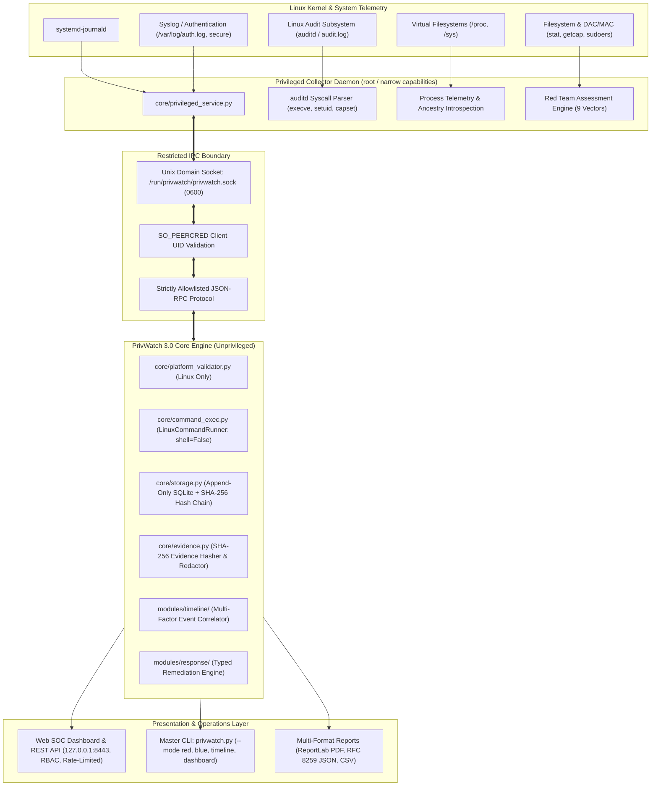

# PrivWatch 3.0 — Platform Architecture Specification

**Status:** Hardened Linux-Native Baseline  
**Version:** 3.0.0  
**Target Environment:** 100% Linux (Kali, Debian, Ubuntu, Fedora, RHEL, Arch)  

---

## 1. System Philosophy & Non-Negotiables

PrivWatch 3.0 is a modular, evidence-driven security platform engineered for Linux privilege escalation auditing, continuous telemetry monitoring, forensic incident reconstruction, and controlled defensive remediation.

### Core Non-Negotiables
1. **Linux-Only Native Execution:** PrivWatch enforces 100% Linux-native interfaces. All Windows/macOS compatibility code, fallbacks, and degraded modes have been eliminated. Non-Linux OS startup is rejected immediately.
2. **Safe Subprocess Execution (`shell=False`):** The entire application strictly forbids `shell=True` and subshell invocation. All command executions use argument lists (`List[str]`), binary path verification (`shutil.which()`), timeouts, and separate stdout/stderr handling via `LinuxCommandRunner`.
3. **No Fabricated Telemetry:** Every alert, finding, and event originates from verifiable system telemetry (`auditd`, `journald`, `auth.log`, `/proc`, filesystem stat).
4. **Daemon Privilege Separation:** The unprivileged SOC Web UI / REST API communicates with the privileged collector daemon over a restricted Unix Domain Socket (`/run/privwatch/privwatch.sock`) with `0600` permissions and `SO_PEERCRED` validation.
5. **Controlled Typed Remediation:** Playbooks use strongly-typed `RemediationAction` structures, capture original permission bits, enforce dry-runs by default, require confirmation, create pre-execution backups, and execute atomic reverse-order rollbacks on failure.
6. **Cryptographic Evidence Integrity:** Administrative actions and security events are preserved in an append-only SQLite store with SHA-256 cryptographic hash chaining (`prev_hash` -> `record_hash`).

---

## 2. High-Level Architecture Diagram

---

## 3. Operational Engines

### A. Red Team Assessment Engine (9 Attack Vectors)
- **SUID/SGID (`suid_scanner.py`):** Identifies elevated binaries, checks parent directory permissions, matches GTFOBins risks, and avoids root false positives.
- **Sudoers (`sudo_scanner.py`):** Audits NOPASSWD rules, broad wildcards, dangerous binaries, and configuration file write permissions.
- **Linux Capabilities (`capabilities_scanner.py`):** Evaluates `cap_setuid`, `cap_dac_override`, `cap_sys_admin`, `cap_sys_ptrace`, etc. via `getcap`.
- **Cron & Systemd (`cron_scanner.py`):** Audits `/etc/crontab`, `/etc/cron.*`, systemd timers, and referenced script write permissions.
- **Authentication Databases (`passwd_scanner.py`):** Verifies `/etc/passwd` and `/etc/shadow` ownership, rogue UID 0 accounts, and empty password fields.
- **Kernel Vulnerabilities (`kernel_scanner.py`):** Distribution-aware evaluation against USN, DSA, and RHSA advisories with Debian/RPM package comparison.
- **PATH Hijacking (`path_scanner.py`):** Evaluates relative `.` entries and writable directories in PATH.
- **SSH Security (`ssh_scanner.py`):** Audits `PermitRootLogin`, `PermitEmptyPasswords`, private host keys, and `authorized_keys`.
- **Container Boundaries (`container_scanner.py`):** Detects writable Docker sockets (`/var/run/docker.sock`), raw host block devices, and container escapes.

### B. Blue Team Telemetry & Detection Engine
- Ingests structured events from `auditd`, `systemd-journald`, `auth.log`, and `/proc`.
- Detects repeated authentication failures, EUID transitions, web shell spawning, SUID execution bursts, and crontab tampering.
- Explicitly reports degraded telemetry coverage when `auditd` is unavailable.

### C. Forensic Timeline & Correlation Engine
- Multi-factor correlation linking events across `user`, `host`, `pid`, `ppid`, `process`, and chronological time windows.
- Prevents cross-user false correlation.
- Maps detected attack chains to MITRE ATT&CK tactics.

### D. Controlled Response Engine
- Implements `RemediationAction` structures with exact original permission bits.
- Enforces dry-run default, explicit confirmation gates, pre-execution backups, and atomic reverse rollbacks on partial failure.
