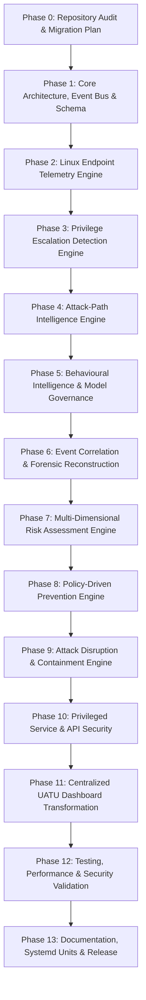

# UATU Linux Edition - Master Migration & Implementation Plan

## 1. Migration Overview & Guiding Philosophy

The objective of this migration is to transform the existing PrivWatch codebase into **UATU Linux Edition — Intelligent Privilege Escalation Detection, Prevention, and Attack-Path Disruption**.

### Fundamental Rules:
1. **Preserve Foundation**: Retain working modules in `core/`, `modules/`, `ml/`, and `models/`. Do not delete or discard functional code.
2. **100% Linux-Native**: Strictly avoid Windows compatibility layers, Windows APIs, and cross-platform workarounds. Windows is explicitly unsupported.
3. **No Fake Functionality**: Every detection, attack path, policy evaluation, and containment action must have traceable Linux evidence or explicit degraded-mode reporting.
4. **Phase-by-Phase Validation**: Each phase must be verified with automated unit and integration tests before proceeding to subsequent phases.

---

## 2. Phase-by-Phase Roadmap

---

## 3. Detailed Phase Breakdown

### Phase 0: Repository Audit and Migration Plan (Current Phase)
- **Objective**: Complete codebase inspection, defect registration, architecture mapping, and traceability matrix creation.
- **Deliverables**:
  - `docs/UATU_REPOSITORY_AUDIT.md`
  - `docs/UATU_DEFECT_REGISTER.md`
  - `docs/UATU_MIGRATION_PLAN.md`
  - `docs/UATU_REQUIREMENTS_TRACEABILITY.md`
- **Exit Criteria**: All 4 documents authored, defects registered, baseline test suite (69 tests) green.

---

### Phase 1: Core Architecture, Event Bus & Extended Event Schema
- **Objective**: Establish typed event models, database schema migrations, and asynchronous event bus.
- **Key Modules**:
  - `core/event_bus.py`: In-memory thread-safe pub/sub event router for decoupling telemetry from detection and containment.
  - `core/models.py`: Extend data models with `AttackNode`, `AttackEdge`, `AttackPath`, `SecurityPolicy`, `ContainmentAction`, `RiskScoreCard`, `NetworkSocketEvent`.
  - `core/storage.py`: SQLite schema migration adding tables: `attack_nodes`, `attack_edges`, `attack_paths`, `policies`, `policy_evaluations`, `containment_records`, `network_sockets`.
- **Exit Criteria**: Schema migration tests pass; existing events and findings remain intact; event bus verified with multi-subscriber unit tests.

---

### Phase 2: Linux Endpoint Telemetry Engine
- **Objective**: Build a comprehensive, distribution-aware Linux telemetry engine with capability detection.
- **Key Modules**:
  - `telemetry/network/socket_collector.py`: Collects listening ports, active TCP/UDP connections, and PID-to-socket bindings via `/proc/net/` and `ss`.
  - `telemetry/process/process_collector.py`: Enhanced process monitor capturing PIDs, PPIDs, UID/EUID, cgroups, namespaces, and execution context.
  - `telemetry/provenance.py`: Strict classification of telemetry into observed facts, derived facts, and degraded-mode reporting.
- **Exit Criteria**: Socket-to-process correlation verified; degraded-mode warnings triggered when auditd is inactive.

---

### Phase 3: Privilege Escalation Detection Engine
- **Objective**: Harmonize Red Team audit scanners into a unified real-time detection framework.
- **Key Modules**:
  - `detection/privilege/`: Unified rules for SUID/SGID abuse, sudoers wildcard/NOPASSWD, dangerous capabilities, cron/systemd writable scripts, and distribution kernel CVEs.
  - `detection/engine.py`: Evaluates incoming telemetry events and filesystem states, producing typed `Detection` objects with explicit risk and remediation guidance.
- **Exit Criteria**: All 9 privilege escalation vectors detect reproducible lab scenarios with zero false positives on root-owned secure configurations.

---

### Phase 4: Attack-Path Intelligence Engine
- **Objective**: Implement a genuine directed attack graph modeling transitive privilege escalation paths.
- **Key Modules**:
  - `attack_path/nodes.py`: Node entities (User, Group, Process, Binary, File, Service, CronJob, Capability).
  - `attack_path/edges.py`: Edge relationships (`MEMBER_OF`, `CAN_EXECUTE`, `CAN_MODIFY`, `EXECUTES_AS`, `HAS_CAPABILITY`, `SPAWNS`).
  - `attack_path/graph.py`: Directed graph data structure with cycle detection and graph snapshotting.
  - `attack_path/traversal.py`: Shortest-path search algorithms identifying reachable root privilege targets from unprivileged accounts.
  - `attack_path/prioritization.py`: Exploitability and path-length scoring identifying critical "choke points" where remediation disrupts multiple paths.
- **Exit Criteria**: Transitive multi-hop privilege escalation paths correctly discovered and serialized for API/Dashboard visualization.

---

### Phase 5: Behavioural Intelligence & Model Governance
- **Objective**: Strengthen machine learning layers with cryptographic manifests and provenance protection.
- **Key Modules**:
  - `ml/validation/signed_manifest.py`: HMAC-SHA256 authenticated model manifests preventing local weight replacement.
  - `models/`: Integration of anomaly scores, Random Forest classification, and Markov sequence likelihood into attack-path edge weights.
- **Exit Criteria**: Tampered model files and unsigned manifests rejected; inference latency verified $\le 5.0$ ms.

---

### Phase 6: Event Correlation & Forensic Reconstruction
- **Objective**: Generalized multi-stage incident correlation linking isolated events into attack timelines.
- **Key Modules**:
  - `correlation/engine.py`: Dynamic incident builder using process ancestry (PPID-to-PID), session IDs, and time windows.
  - `forensics/timeline.py`: Unified chronological reconstruction of events, findings, configuration modifications, and responses.
  - `forensics/evidence.py`: Cryptographic chain-of-custody verification.
- **Exit Criteria**: Generalized multi-step privilege attack sequence (e.g. brute force $\to$ login $\to$ script tamper $\to$ root execution) correlates into a single verified incident.

---

### Phase 7: Multi-Dimensional Risk Assessment Engine
- **Objective**: Replace simplistic linear penalty arithmetic with decoupled risk dimensions.
- **Key Modules**:
  - `risk/scoring.py`: Computes orthogonal scores for Privilege Impact (0-100), Exploitability (0-100), Exposure (0-100), Attack Path Proximity (0-100), Evidence Reliability (0-100), and Composite Risk Index.
  - `risk/prioritization.py`: Ranks findings, incidents, and attack paths based on risk density.
- **Exit Criteria**: Decoupled risk calculations tested across edge and boundary conditions with documented rationale.

---

### Phase 8: Policy-Driven Prevention Engine
- **Objective**: Implement proactive Linux-native policy enforcement.
- **Key Modules**:
  - `prevention/policy.py`: Policy schema (rules, protected resources, allowed actors, enforcement modes).
  - `prevention/evaluator.py`: Real-time policy evaluation against security events and proposed actions.
  - `prevention/enforcement/`: Linux-native enforcement mechanisms:
    - Capabilities restriction (`cap_set_proc`, file capability stripping).
    - Systemd service security directives (`ProtectSystem=strict`, `NoNewPrivileges=true`).
    - Filesystem ACL locks (`setfacl`).
    - cgroup execution constraints.
  - Safe rollout modes: `MONITOR_ONLY`, `EVALUATION`, `APPROVAL_REQUIRED`, `ENFORCED`.
- **Exit Criteria**: Prevention policies block unauthorized simulated transitions without causing administrative lockout.

---

### Phase 9: Attack Disruption & Containment Engine
- **Objective**: Implement controlled, verifiable Linux-native attack disruption.
- **Key Modules**:
  - `response/containment.py`:
    - Process termination (`SIGTERM`/`SIGKILL`) with PID start-time validation against PID reuse.
    - Process freezing via `SIGSTOP`.
    - Process isolation via Linux namespaces (`unshare -m -n -p`).
    - Network containment via `nftables`/`iptables` local connection drop.
    - Anti-lockout safeguards: Whitelist protecting PID 1, systemd, SSH sessions, and root administrative shells.
  - Independent post-action verification (confirming target is no longer executing).
- **Exit Criteria**: Simulated rogue process terminated and independently verified; critical processes refused protection bypass.

---

### Phase 10: Privileged Service & API Security
- **Objective**: Secure least-privilege IPC and REST API.
- **Key Modules**:
  - `privileged_service/server.py`: Unix domain socket daemon (`/run/uatu/uatu.sock`, mode `0600`) with `SO_PEERCRED` caller UID checks and allowlisted RPC actions (including containment operations).
  - `web/app.py`: Fine-grained RBAC roles (`Viewer`, `Analyst`, `Security Administrator`, `Authorized Responder`), token-bucket rate limiting, and audit logging.
- **Exit Criteria**: Unauthenticated or unauthorized callers rejected with HTTP 401/403; privileged socket verifies peer credentials.

---

### Phase 11: Centralized UATU Dashboard Transformation
- **Objective**: Full UI transformation into the enterprise UATU Security Operations Dashboard.
- **Key Pages**:
  1. *Security Overview*: Posture, active containment, top attack paths, source health.
  2. *Live Monitoring*: Real-time process, auth, network, and audit streams.
  3. *Attack-Path Explorer*: Interactive graph visualization of discovered privilege paths.
  4. *Threat Detection*: Detailed alerts with feature explainability.
  5. *Incident Investigation*: Forensic timeline and process ancestry tree.
  6. *Prevention Center*: Active policies, violations, and enforcement rollout controls.
  7. *Containment Center*: Active process freezes, terminations, and network drops.
  8. *Security Posture*: Red Team scanner findings and configuration drift.
  9. *ML Intelligence*: Model registry cards, drift PSI, and latency profiles.
  10. *Forensics & Reports*: PDF, JSON, and CSV exports with cryptographic evidence hashes.
  11. *System Settings*: Service status, telemetry configuration, and RBAC users.
- **Exit Criteria**: All 11 pages render live backend data; no hardcoded counters or placeholder buttons.

---

### Phase 12: Comprehensive Testing, Performance & Security Validation
- **Objective**: Rigorous regression, unit, integration, and security penetration testing.
- **Test Categories**:
  - Unit tests for all new modules (`attack_path`, `prevention`, `containment`, `network`).
  - Integration tests for end-to-end telemetry $\to$ attack path $\to$ containment flow.
  - Security tests: command injection, path traversal, PID reuse, symlink race conditions, API auth bypass.
- **Exit Criteria**: 100% green test suite; zero regressions.

---

### Phase 13: Documentation, Systemd Units & Release
- **Objective**: Complete documentation suite, CLI entry points, systemd packaging, and release delivery.
- **Deliverables**:
  - `uatu.py` primary CLI (with `privwatch.py` backwards-compatibility alias).
  - `systemd/uatu.service` and `systemd/uatu-collector.service`.
  - Comprehensive documentation set (22 markdown documents in `docs/`).
- **Exit Criteria**: Ready for production deployment on Kali, Debian, Ubuntu, and RHEL Linux endpoints.
